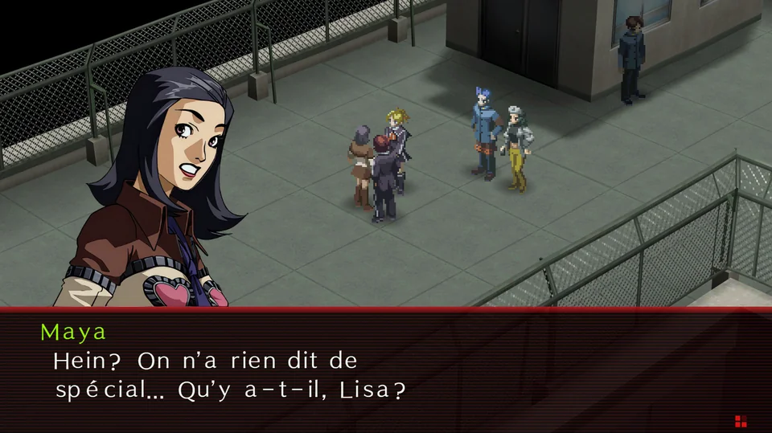
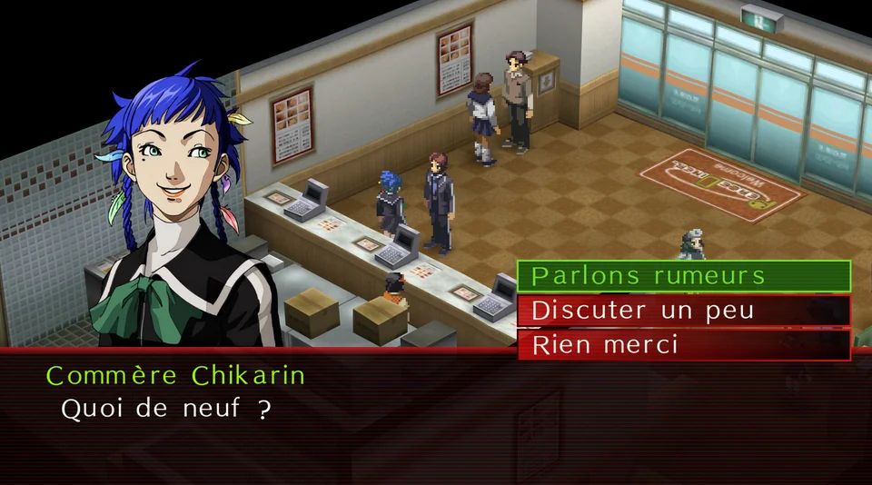
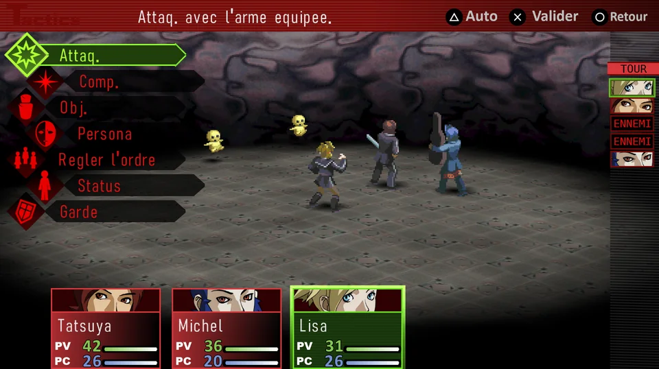
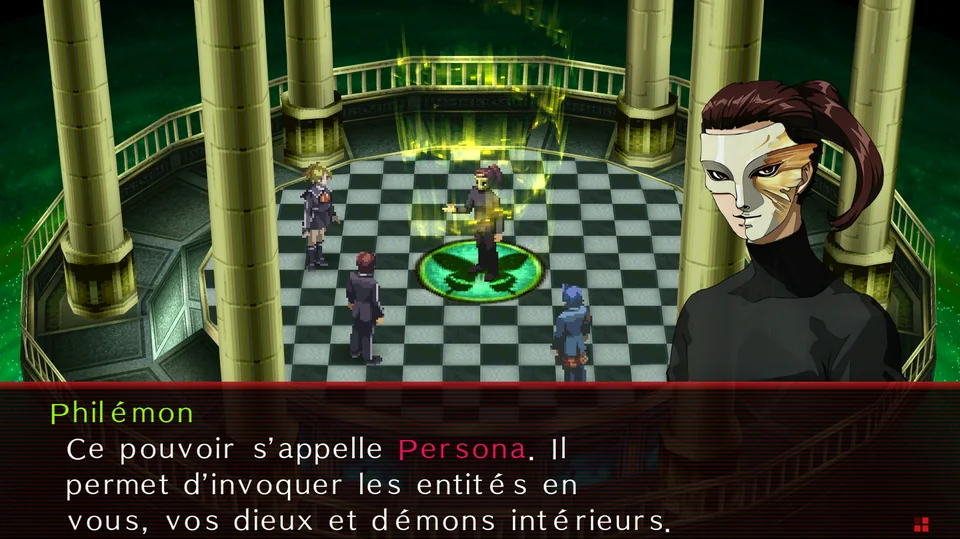
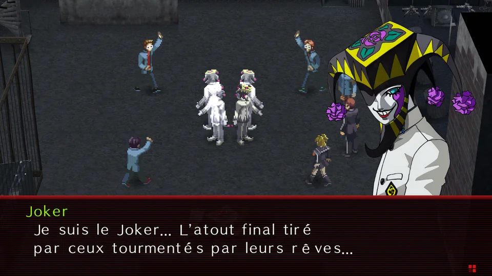

<p align="center">
  
</p>

<p align="center">
  <a href="https://github.com/Grimoire-du-Coeur/P2-IS-FR-PSP/releases"></a>
  <a href="https://personalegrimoireducoeur.fr/patcher/"></a>
  <a href="https://discord.gg/rd4ckSWHNm"></a>
  
</p>

<p align="center">
  <a href="https://github.com/Grimoire-du-Coeur/P2-IS-FR-PSP/actions/workflows/qualite.yml"></a>
  <a href="https://github.com/Grimoire-du-Coeur/P2-IS-FR-PSP/commits/main"></a>
  <a href="https://github.com/Grimoire-du-Coeur/P2-IS-FR-PSP/issues"></a>
  <a href="https://github.com/Grimoire-du-Coeur/P2-IS-FR-PSP/stargazers"></a>
  <a href="./LICENSE"></a>
</p>


**Fan-traduction française de *Persona 2: Innocent Sin*** sur PSP
(version européenne, `ULES01557`).

Sorti au Japon en 1999, puis refait sur PSP en 2011, *Innocent Sin* n'a
jamais eu de version française officielle. Ce dépôt réunit tout le projet :
le patch jouable, les outils de romhacking écrits pour l'occasion, et la
documentation accumulée en démontant le moteur Atlus.

À Sumaru, une rumeur court les couloirs du lycée Seven Sisters : il
suffirait d'appeler son propre numéro pour que le Joker apparaisse et
exauce un vœu. Tatsuya Suou va vite comprendre que dans cette ville, **les
rumeurs deviennent réalité**, et qu'il a déjà rencontré, enfant, ceux qui
se battront à ses côtés.

Le projet a été **créé et mené par [chene](https://github.com/chenetulipe)** :
reverse-engineering du moteur, outils d'extraction et de réinjection,
patcher. **[Hamza](https://github.com/CodeByHaamza)** a porté la traduction
de l'histoire jusqu'à 100 %, harmonisé la terminologie et bâti la
[plateforme de relecture](https://codebyhaamza.github.io/p2is-relecture/) ;
**[Garloulou](https://github.com/Garloulou)** a intégré les premières
contributions. Il est porté par la communauté du
**[Grimoire du Cœur](https://github.com/Grimoire-du-Coeur)**
— tous les noms sont dans les [crédits](docs/CREDITS.md).

<br clear="right">

> [!IMPORTANT]
> **Le scénario, les menus, les objets et les combats sont traduits.** Le
> patch reste en bêta : il s'agit maintenant de relire en jeu, pas de
> traduire. Une coquille, un texte coupé, un plantage ?
> [Ouvre une issue](https://github.com/Grimoire-du-Coeur/P2-IS-FR-PSP/issues/new/choose).


<a name="le-jeu-en-francais"></a>
## Le jeu en français

<table>
  <tr>
    <td width="33%"></td>
    <td width="33%"></td>
    <td width="33%"></td>
  </tr>
  <tr>
    <td></td>
    <td></td>
    <td></td>
  </tr>
</table>

<p align="center">
  <a href="https://youtu.be/rGHRMPw-bbo"></a>
  <a href="https://youtu.be/vuuCnP3waik"></a>
  <br>
  <sub>À gauche, le jeu en français ; à droite, le tutoriel d'installation. Plus de captures sur
  <a href="https://personalegrimoireducoeur.fr/">le site du Grimoire</a>.</sub>
</p>


<a name="installation"></a>
## Installation

> [!NOTE]
> Le patch cible **uniquement** la version européenne `ULES01557`. Aucune
> image du jeu n'est distribuée ici : il faut ta propre ISO, extraite de ton UMD.

**1. Patcher l'ISO**

1. Récupère le `.xdelta` de la [dernière version](https://github.com/Grimoire-du-Coeur/P2-IS-FR-PSP/releases).
2. Ouvre le **[patcher en ligne](https://personalegrimoireducoeur.fr/patcher/)** : rien à
   installer, et ton ISO ne quitte jamais ton ordinateur.
3. Dépose ton ISO et le `.xdelta`, puis télécharge l'ISO traduite.

**2. Installer les textures** (indispensables pour les accents, sur [PPSSPP](https://www.ppsspp.org/))

1. Télécharge le pack HD de base : [HD UI for Persona 2](https://gamebanana.com/mods/308752).
2. Place-le dans `TEXTURES/ULES01557/` de ton dossier PPSSPP.
3. Ajoute par-dessus le **pack de textures FR** des [releases](https://github.com/Grimoire-du-Coeur/P2-IS-FR-PSP/releases).
4. Active *Remplacer les textures* dans les paramètres de PPSSPP.

> [!WARNING]
> **Sur une vraie PSP**, le pack de textures ne peut pas être installé : les
> accents s'affichent alors comme des caractères japonais. C'est une limite de
> la console, pas un bug du patch (voir [#569](https://github.com/Grimoire-du-Coeur/P2-IS-FR-PSP/issues/569)).
> Et lancer *Install Data* depuis le menu du jeu réinstalle les fichiers
> d'origine : le jeu repasse en anglais.


<a name="avancement"></a>
## Avancement

<p align="center">
  <picture>
    <source media="(prefers-color-scheme: dark)" srcset="docs/assets/progression-sombre.svg">
    <source media="(prefers-color-scheme: light)" srcset="docs/assets/progression-clair.svg">
    
  </picture>
  <sub>Recompté depuis <code>traduction/</code> par <a href="docs/assets/generer_progression.py"><code>generer_progression.py</code></a> : rien n'est saisi à la main.</sub>
</p>

<p align="center">
  <picture>
    <source media="(prefers-color-scheme: dark)" srcset="docs/assets/dialogue-sombre.svg">
    <source media="(prefers-color-scheme: light)" srcset="docs/assets/dialogue-clair.svg">
    
  </picture>
  <sub>De vraies répliques, tirées telles quelles de <code>traduction/event_scripts/</code>.</sub>
</p>

L'historique des versions et les notes de patch sont dans [SUIVI.md](docs/SUIVI.md).


<a name="participer"></a>
## Participer

Tout est traduit, tout reste à vérifier en jeu : **la relecture est l'aide
la plus utile aujourd'hui.**

1. **Rejoins le [Discord du Grimoire du Cœur](https://discord.gg/rd4ckSWHNm)** :
   c'est là qu'on se répartit les relectures et qu'on discute des tournures.
2. **Signale** une coquille, un texte coupé ou un plantage dans les
   [issues](https://github.com/Grimoire-du-Coeur/P2-IS-FR-PSP/issues/new/choose),
   avec une capture si possible.
3. **Propose une correction** : lis le [guide de contribution](CONTRIBUTING.md),
   puis ouvre une Pull Request. Le [Dictionnaire](docs/Dictionnaire.md) fait
   référence pour le vocabulaire, avant les préférences de chacun.

> [!CAUTION]
> **La place est comptée.** Un texte plus long que la case prévue dans le jeu
> le fait planter. `verify_json` et `check_overflows` tournent sur chaque Pull
> Request, et en local avec `pre-commit install`.


<a name="organisation-du-depot"></a>
## Organisation du dépôt

```text
P2-IS-FR-PSP/
├── traduction/        ← le texte du jeu, en JSON : le cœur du projet
│   ├── event_scripts/   399 scripts d'évènement
│   ├── EBOOT_decoupe/   menus et système, en 7 parties
│   └── *.json           cartes (MMAP), combats (F_BE), cinématiques (TM_EVE), boutique de CD
├── p2is/              ← le noyau, importable partout
│   ├── core/            formats du jeu : CPK, ISO, CRILAYLA, moteur de texte
│   ├── parsers/         lecture des conteneurs (EBOOT, F_BE, .BIN)
│   ├── encoders/        réinjection, reconstruction des tables de pointeurs
│   └── outils/          vérifications et correctifs en ligne de commande
├── labs/              ← les ateliers : traduction (web), images GIM, audio ATRAC3
├── patcher/           ← le patcher web (xdelta3 en WebAssembly)
├── docs/              ← documentation technique, dictionnaire, crédits
└── tests/             ← suite pytest du noyau
```

> [!NOTE]
> `index.html` et `patcher/` restent à la racine : **GitHub Pages publie ce
> dépôt depuis `main:/`**. Les déplacer casserait le site et le patcher en ligne.

<a name="la-chaine-doutils"></a>
### La chaîne d'outils

Aucun outil existant ne gérait les particularités du moteur Atlus sur PSP :
pointeurs absolus, cases de taille fixe, archives CPK, compression CRILAYLA.
Tout a donc été écrit ici.

```bash
pip install -r requirements.txt    # dépendances des ateliers
pip install -e .                   # le noyau p2is seul
```

<details>
<summary><b>labs/tool</b> — l'atelier de traduction &nbsp;·&nbsp; <code>FastAPI · React</code></summary>

<br>

Application web locale pour extraire, traduire et réinjecter les scripts à
plusieurs : extraction depuis l'ISO, décodage du bytecode Atlus,
reconstruction des tables de pointeurs absolus, réinjection dans le CPK.

```bash
python -m labs.tool.server.server
```

</details>

<details>
<summary><b>labs/image</b> — l'atelier d'images &nbsp;·&nbsp; <code>FastAPI · React</code></summary>

<br>

Images au format GIM compressé CRILAYLA (écrans de chargement, interface).
Embarque un compresseur CRILAYLA en Python pur, pour réinjecter une image
sans dépasser la place prévue dans l'ISO.

```bash
python -m labs.image.server.server_image
```

</details>

<details>
<summary><b>labs/audio</b> — l'atelier audio &nbsp;·&nbsp; <code>Python</code></summary>

<br>

Extraction et conversion des pistes ATRAC3 (AT3), en pilotant
ATRACTool-Reloaded en ligne de commande.

```bash
python -m labs.audio.server.server_audio
```

</details>

<details>
<summary><b>patcher</b> — le patcher web &nbsp;·&nbsp; <code>WebAssembly</code></summary>

<br>

xdelta3 compilé en WebAssembly, qui tourne entièrement dans le navigateur :
rien à installer, et l'ISO ne quitte jamais la machine.

</details>

<details>
<summary><b>p2is/outils</b> — les vérifications en ligne de commande</summary>

<br>

| Commande | Rôle |
|:---|:---|
| `python -m p2is.outils.verify_json <fichiers>` | vérifie que les balises de contrôle survivent à la traduction |
| `python -m p2is.outils.check_overflows` | liste les textes trop longs pour leur case |
| `python -m p2is.outils.audit_eboot` | audit des entrées de l'EBOOT |
| `python -m p2is.outils.auto_wrap` | recoupe les retours à la ligne selon les contraintes du jeu |
| `python -m p2is.outils.verify_integrity` | contrôle d'intégrité des fichiers de traduction |

</details>


<a name="documentation"></a>
## Documentation

| Document | Contenu |
|:---|:---|
| [Accueil.md](docs/Accueil.md) | point d'entrée de la doc (s'ouvre aussi comme coffre Obsidian) |
| [CONTRIBUTING.md](CONTRIBUTING.md) | guide de contribution et règles de traduction |
| [Dictionnaire.md](docs/Dictionnaire.md) | glossaire officiel : la référence |
| [DEVELOPER.md](docs/DEVELOPER.md) | architecture, reverse-engineering du moteur, formats, opcodes |
| [ANALYSE.md](docs/ANALYSE.md) | audit du dépôt d'octobre 2026 (archive) |
| [SUIVI.md](docs/SUIVI.md) | historique des versions et notes de patch |
| [CREDITS.md](docs/CREDITS.md) | l'équipe et les contributeurs |

Une question ? La **[FAQ](https://personalegrimoireducoeur.fr/faq.html)** ou le
**[Discord](https://discord.gg/rd4ckSWHNm)**.


<a name="licences-et-responsabilite"></a>
## Licences et responsabilité

> [!WARNING]
> Ce projet ne distribue **aucun fichier du jeu**. Il faut extraire
> soi-même son image disque depuis un UMD que l'on possède.
> *Persona 2: Innocent Sin* est une propriété d'Atlus / SEGA. L'équipe décline
> toute responsabilité en cas de perte de données.

Le patch, les outils (`p2is`, `labs/*`) et le patcher web sont publiés sous
**[CC BY-NC-SA 4.0](https://creativecommons.org/licenses/by-nc-sa/4.0/)** :
réutilisation et modification permises en créditant l'équipe, sans usage
commercial, et sous la même licence. **Les créateurs de contenu (YouTube,
Twitch) peuvent utiliser ce patch et monétiser leurs vidéos normalement.**

| Dépendance tierce | Rôle | Licence |
|:---|:---|:---|
| [`pycdlib`](https://github.com/clalancette/pycdlib) | lecture ISO 9660, importée à la demande | LGPL-2.1 |
| [`ATRACTool-Reloaded`](https://github.com/XyLe-GBP/ATRACTool-Reloaded) | conversion audio AT3, appelé en externe | voir le dépôt |
| `xdelta3` (WebAssembly) | application du patch dans le navigateur | GPL-2.0 |

<br>

<p align="center">
  
  <br>
  <sub>Un projet du <b>Grimoire du Cœur</b> · <a href="https://personalegrimoireducoeur.fr/">personalegrimoireducoeur.fr</a></sub>
</p>
