<div align="center">

<picture>
  <source media="(prefers-color-scheme: dark)" srcset="docs/assets/banniere-sombre.svg">
  <source media="(prefers-color-scheme: light)" srcset="docs/assets/banniere-clair.svg">
  
</picture>

<br/>

[](https://github.com/Grimoire-du-Coeur/P2-IS-FR-PSP/releases/latest)
[](https://personalegrimoireducoeur.fr/patcher/)
[](https://discord.gg/rd4ckSWHNm)

[](https://github.com/Grimoire-du-Coeur/P2-IS-FR-PSP/commits/main)
[](https://github.com/Grimoire-du-Coeur/P2-IS-FR-PSP/issues)
[](https://github.com/Grimoire-du-Coeur/P2-IS-FR-PSP/stargazers)
[](https://github.com/Grimoire-du-Coeur/P2-IS-FR-PSP/actions/workflows/qualite.yml)
[](./LICENSE)

</div>

---

*Persona 2: Innocent Sin* n'a jamais eu de version française officielle. Ce dépôt réunit tout
le projet : le patch jouable, les outils de romhacking écrits pour l'occasion, et la
documentation technique accumulée pendant le reverse-engineering du moteur Atlus.

> [!IMPORTANT]
> **La totalité du texte du jeu est traduite** — scénario, menus, objets, combats.
> Le patch reste en bêta : il s'agit maintenant de relire en jeu, pas de traduire.
> Les retours d'erreurs se font
> [dans les issues](https://github.com/Grimoire-du-Coeur/P2-IS-FR-PSP/issues/new/choose).

<br/>

<div align="center">

<picture>
  <source media="(prefers-color-scheme: dark)" srcset="docs/assets/progression-sombre.svg">
  <source media="(prefers-color-scheme: light)" srcset="docs/assets/progression-clair.svg">
  
</picture>

<sub>Chiffres recomptés depuis <code>traduction/</code> par <a href="./docs/assets/generer_progression.py"><code>generer_progression.py</code></a> — ils ne sont pas saisis à la main.</sub>

<br/><br/>

<picture>
  <source media="(prefers-color-scheme: dark)" srcset="docs/assets/dialogue-sombre.svg">
  <source media="(prefers-color-scheme: light)" srcset="docs/assets/dialogue-clair.svg">
  
</picture>

<sub>Répliques réelles, extraites telles quelles de <code>traduction/event_scripts/</code>.</sub>

</div>

<br/>

<div align="center">

<a href="https://youtu.be/rGHRMPw-bbo"></a>
<a href="https://youtu.be/vuuCnP3waik"></a>

<sub>À gauche : tutoriel d'installation — à droite : aperçu du jeu en français</sub>

</div>

<br/>

## Sommaire

- [Installation](#installation)
- [Organisation du dépôt](#organisation-du-dépôt)
- [La chaîne d'outils](#la-chaîne-doutils)
- [Contribuer](#contribuer)
- [Documentation](#documentation)
- [Licences et responsabilité](#licences-et-responsabilité)

<br/>

## Installation

> [!NOTE]
> Le patch cible **exclusivement** la version européenne `ULES01557`. Aucune image de jeu
> n'est distribuée ici : vous devez fournir votre propre ISO, extraite de votre UMD.

### 1. Patcher l'ISO

1. Récupérez le `.xdelta` de la [dernière release](https://github.com/Grimoire-du-Coeur/P2-IS-FR-PSP/releases/latest).
2. Ouvrez le **[patcher en ligne](https://personalegrimoireducoeur.fr/patcher/)** — rien à installer, tout se passe dans le navigateur.
3. Déposez votre ISO et le `.xdelta`, puis générez l'ISO traduite.

### 2. Installer le pack de textures HD

Indispensable pour afficher correctement les accents français. **Recommandé sur PPSSPP.**

1. Téléchargez le pack HD de base : [HD UI for Persona 2](https://gamebanana.com/mods/308752).
2. Placez-le dans `TEXTURES/ULES01557/` de votre dossier PPSSPP.
3. Superposez par-dessus le **pack de textures FR** issu des [releases](https://github.com/Grimoire-du-Coeur/P2-IS-FR-PSP/releases/latest).
4. Activez *Remplacer les textures* dans les paramètres de PPSSPP.

> [!WARNING]
> **Sur PSP réelle**, le pack de textures HD ne peut pas être installé : les accents
> s'affichent alors comme des caractères japonais. C'est une limite de la console, pas un
> bug du patch — voir [#569](https://github.com/Grimoire-du-Coeur/P2-IS-FR-PSP/issues/569).
> De même, lancer *Install Data* depuis le menu du jeu réinstalle les fichiers d'origine
> et fait repasser le jeu en anglais.

<br/>

## Organisation du dépôt

```
P2-IS-FR-PSP/
├── p2is/              Le noyau. Aucune dépendance d'interface : importable partout.
│   ├── core/          Formats du jeu : CPK, ISO, CRILAYLA, moteur de texte
│   ├── parsers/       Lecture des conteneurs (EBOOT, F_BE, .BIN)
│   ├── encoders/      Réinjection et reconstruction des tables de pointeurs
│   ├── outils/        Outils en ligne de commande (vérification, audit, correctifs)
│   └── tables.py      Opcodes Atlus, table d'accents, magic bytes
│
├── labs/              Les trois ateliers, bâtis au-dessus du noyau
│   ├── tool/          Atelier de traduction (web, FastAPI + React)
│   ├── image/         Atelier d'images GIM / CRILAYLA
│   └── audio/         Atelier audio ATRAC3
│
├── traduction/        Les données de traduction — le cœur du projet
│   ├── event_scripts/ 399 scripts d'évènement
│   ├── EBOOT_decoupe/ EBOOT découpé en 7 parties
│   └── *.json         MMAP, F_BE, TM_EVE, CD_SHOP
│
├── patcher/           Patcher xdelta3 WebAssembly, autonome
├── docs/              Documentation technique et assets du README
├── tests/             Suite pytest du noyau
└── index.html         Redirection GitHub Pages vers le site officiel
```

> [!NOTE]
> `index.html` et `patcher/` restent à la racine : **GitHub Pages publie ce dépôt depuis
> `main:/`**. Les déplacer casserait le site et le patcher en ligne.

<br/>

## La chaîne d'outils

Aucun outil existant ne gérait les particularités du moteur Atlus PSP : pointeurs absolus,
slots de taille fixe, archives CPK et compression CRILAYLA. Tout a donc été écrit ici.

```bash
pip install -r requirements.txt    # dépendances des ateliers
pip install -e .                   # le noyau p2is seul
```

<details>
<summary><b>labs/tool</b> — l'atelier de traduction &nbsp;·&nbsp; <code>FastAPI · React</code></summary>

<br/>

Application web locale pour extraire, traduire et réinjecter les scripts de façon
collaborative. Elle couvre l'extraction depuis l'ISO, le décodage du bytecode Atlus, la
reconstruction des tables de pointeurs absolus et la réinjection dans l'archive CPK.

```bash
python -m labs.tool.server.server
```

</details>

<details>
<summary><b>labs/image</b> — l'atelier d'images &nbsp;·&nbsp; <code>FastAPI · React</code></summary>

<br/>

Manipulation des images au format GIM compressé CRILAYLA (écrans de chargement, éléments
d'interface). Embarque un compresseur CRILAYLA *greedy* en Python pur, pour réinjecter des
images sans dépasser les contraintes de taille de l'ISO.

```bash
python -m labs.image.server.server_image
```

</details>

<details>
<summary><b>labs/audio</b> — l'atelier audio &nbsp;·&nbsp; <code>Python</code></summary>

<br/>

Extraction et conversion des pistes au format propriétaire ATRAC3 (AT3), en pilotant
ATRACTool-Reloaded en ligne de commande.

```bash
python -m labs.audio.server.server_audio
```

</details>

<details>
<summary><b>patcher</b> — le patcher web &nbsp;·&nbsp; <code>WebAssembly</code></summary>

<br/>

Application autonome tournant entièrement dans le navigateur (xdelta3 compilé en WASM).
Aucune dépendance à installer côté utilisateur, et l'ISO ne quitte jamais la machine.

</details>

<details>
<summary><b>p2is/outils</b> — les outils en ligne de commande</summary>

<br/>

| Commande | Rôle |
|:---|:---|
| `python -m p2is.outils.verify_json <fichiers>` | Vérifie que les balises de contrôle survivent à une traduction |
| `python -m p2is.outils.check_overflows` | Liste les dépassements de slot dans les scripts |
| `python -m p2is.outils.audit_eboot` | Audit des entrées de l'EBOOT |
| `python -m p2is.outils.auto_wrap` | Recoupe les retours à la ligne selon les contraintes du jeu |
| `python -m p2is.outils.verify_integrity` | Contrôle d'intégrité des fichiers de traduction |

</details>

<br/>

## Contribuer

Les relectures et corrections sont la contribution la plus utile aujourd'hui : tout est
traduit, tout reste à vérifier en jeu.

- **Signaler une erreur de traduction, un crash ou un texte coupé** →
  [ouvrir une issue](https://github.com/Grimoire-du-Coeur/P2-IS-FR-PSP/issues/new/choose)
- **Proposer une correction** → lire [CONTRIBUTING.md](./CONTRIBUTING.md), puis ouvrir une pull request
- **Vocabulaire** → le [Dictionnaire](./docs/Dictionnaire.md) fait référence et prime sur les préférences personnelles

> [!CAUTION]
> **La contrainte de longueur est critique.** Un texte traduit plus long que son slot
> binaire fait planter le jeu. `verify_json` et `check_overflows` tournent en
> intégration continue sur chaque pull request — et en local via `pre-commit install`.

<br/>

## Documentation

| Document | Contenu |
|:---|:---|
| [DEVELOPER.md](./docs/DEVELOPER.md) | Architecture technique, reverse-engineering du moteur, formats, opcodes |
| [Dictionnaire.md](./docs/Dictionnaire.md) | Glossaire officiel de traduction — la référence |
| [ANALYSE.md](./docs/ANALYSE.md) | Analyse des formats et des données du jeu |
| [SUIVI.md](./docs/SUIVI.md) | Historique des versions et notes de patch |
| [CREDITS.md](./docs/CREDITS.md) | Équipe et contributeurs |
| [CONTRIBUTING.md](./CONTRIBUTING.md) | Guide de contribution et règles de traduction |

Besoin d'aide ? La **[FAQ](https://personalegrimoireducoeur.fr/faq.html)** ou le
**[Discord](https://discord.gg/rd4ckSWHNm)**.

<br/>

## Licences et responsabilité

> [!WARNING]
> Ce projet ne distribue **aucun fichier original du jeu, ni aucune ROM**. Vous devez
> extraire légalement votre propre image disque depuis un UMD que vous possédez.
> *Persona 2: Innocent Sin* est une propriété d'Atlus / SEGA. L'équipe décline toute
> responsabilité en cas de corruption de données.

Le patch, les outils maison (`p2is`, `labs/*`) et le patcher web sont publiés sous
**[CC BY-NC-SA 4.0](https://creativecommons.org/licenses/by-nc-sa/4.0/)** : réutilisation et
modification autorisées à condition de créditer l'équipe, de ne pas en faire un usage
commercial et de redistribuer sous la même licence. **Les créateurs de contenu (YouTube,
Twitch) peuvent utiliser ce patch et monétiser leurs vidéos normalement.**

| Dépendance tierce | Rôle | Licence |
|:---|:---|:---|
| [`pycdlib`](https://github.com/clalancette/pycdlib) | Lecture ISO 9660, importée dynamiquement | LGPL-2.1 |
| [`ATRACTool-Reloaded`](https://github.com/XyLe-GBP/ATRACTool-Reloaded) | Conversion audio AT3, appelé en externe | voir le dépôt |
| `xdelta3` (WASM) | Application du patch dans le navigateur | GPL-2.0 |

<br/>

<div align="center">
<sub>Un projet <b>Grimoire du Cœur</b> · <a href="https://personalegrimoireducoeur.fr/">personalegrimoireducoeur.fr</a></sub>
</div>
