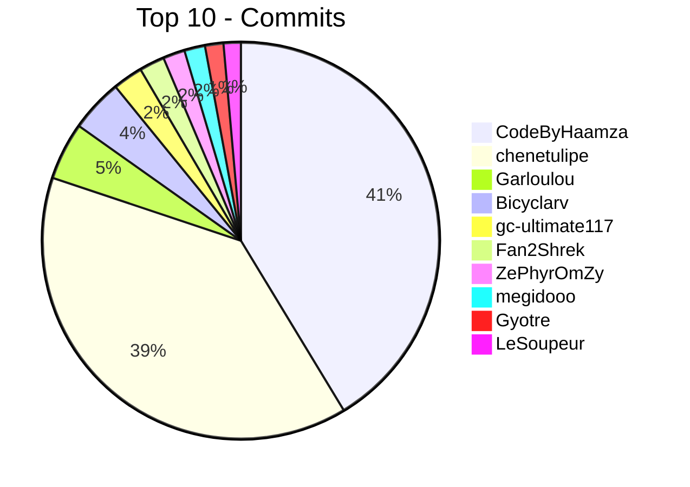
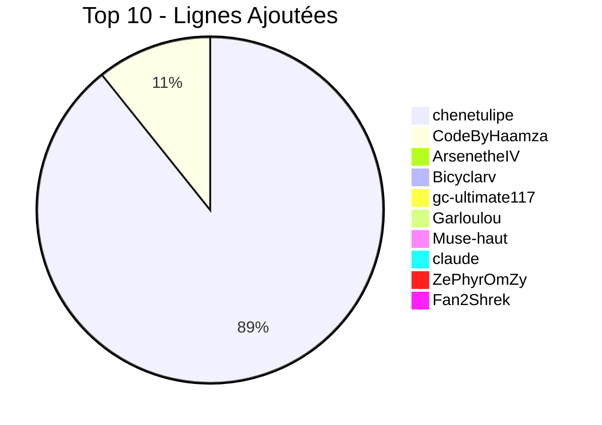
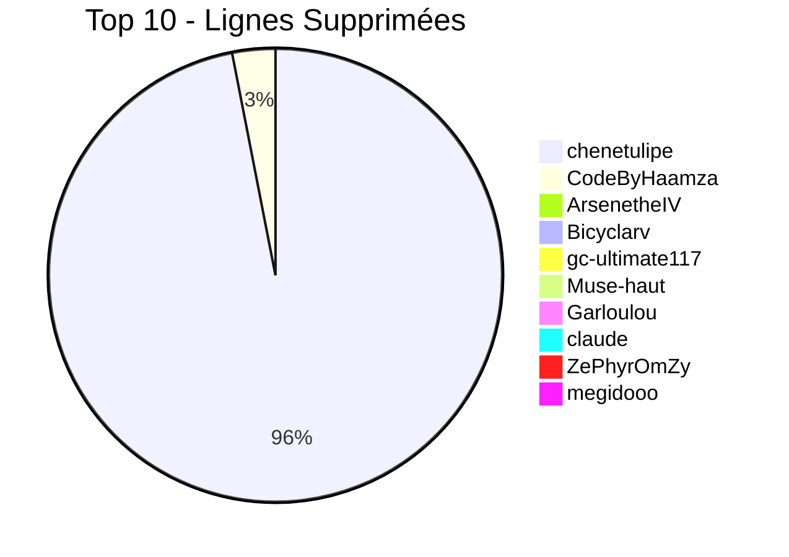

# Crédits - Persona 2: Innocent Sin FR

**Persona 2: Innocent Sin FR (PSP) - ULES01557**

 

 

---

## Équipe Principale

### [@chenetulipe](https://github.com/chenetulipe) - Chef de Projet

Créateur et pilier du projet depuis l'origine. Responsable de l'intégralité du travail de reverse-engineering : extraction, analyse du bytecode Atlus, développement de la chaîne d'outils (labs/tool, labs/image, labs/audio, p2is_cpk_tool, patcher), et coordination générale du projet.

### [@CodeByHaamza](https://github.com/CodeByHaamza) - Développeur & Traducteur Principal

A abattu un travail considérable sur les scripts du jeu, atteignant et validant les 100% de complétion de l'histoire. A harmonisé la terminologie sur l'ensemble des fichiers traduits. A développé de zéro la plateforme web de relecture « P2IS Relecture » pour centraliser et sécuriser le travail collaboratif de l'équipe.

### [@Garloulou](https://github.com/Garloulou) - Support & Intégration

A contribué aux fondations du projet lors de ses premières semaines, notamment en gérant les fusions de contributions communautaires (Merge Pull Requests) sur GitHub, apportant un soutien d'intégration précieux lors de la montée en charge du projet.

 

---

## Contributeurs Communautaires

Merci à toutes les personnes qui ont contribué à la traduction, à la relecture, aux tests ou à la promotion du projet. Le classement complet des contributeurs est disponible dans l'onglet [Insights → Contributors](https://github.com/Grimoire-du-Coeur/P2-IS-FR-PSP/graphs/contributors) du dépôt GitHub.

### Statistiques des contributions

<!-- Section regeneree chaque nuit par .github/workflows/update_credits.yml.
     Ne pas editer a la main : tout ce qui est entre les deux balises est remplace. -->

<!-- STATS_START -->

### Statistiques Globales du Code

| Contributeur | 💾 Commits | ➕ Lignes Ajoutées | ➖ Lignes Supprimées |
|:---|:---:|:---:|:---:|
| **[@CodeByHaamza](https://github.com/CodeByHaamza)** | 441 | +299135 | -75812 |
| **[@chenetulipe](https://github.com/chenetulipe)** | 414 | +2485042 | -2396450 |
| **[@Garloulou](https://github.com/Garloulou)** | 50 | +769 | -517 |
| **[@Bicyclarv](https://github.com/Bicyclarv)** | 46 | +3311 | -3311 |
| **[@gc-ultimate117](https://github.com/gc-ultimate117)** | 26 | +1503 | -1503 |
| **[@Fan2Shrek](https://github.com/Fan2Shrek)** | 22 | +395 | -356 |
| **[@ZePhyrOmZy](https://github.com/ZePhyrOmZy)** | 19 | +403 | -403 |
| **[@megidooo](https://github.com/megidooo)** | 18 | +386 | -386 |
| **[@Gyotre](https://github.com/Gyotre)** | 16 | +355 | -352 |
| **[@LeSoupeur](https://github.com/LeSoupeur)** | 15 | +163 | -163 |
| **[@ArsenetheIV](https://github.com/ArsenetheIV)** | 14 | +10059 | -11358 |
| **[@Tausc0](https://github.com/Tausc0)** | 12 | +62 | -62 |
| **[@Seb180212](https://github.com/Seb180212)** | 10 | +206 | -203 |
| **[@FrankoPaulo](https://github.com/FrankoPaulo)** | 9 | +117 | -117 |
| **[@IssaPagi](https://github.com/IssaPagi)** | 9 | +85 | -85 |
| **[@vkt2rii](https://github.com/vkt2rii)** | 9 | +308 | -309 |
| **[@Ethan-LDS](https://github.com/Ethan-LDS)** | 7 | +169 | -169 |
| **[@Overlowd](https://github.com/Overlowd)** | 7 | +7 | -7 |
| **[@All4nRL](https://github.com/All4nRL)** | 6 | +61 | -61 |
| **[@chaytheninja](https://github.com/chaytheninja)** | 5 | +100 | -99 |
| **[@IovWLordWarth](https://github.com/IovWLordWarth)** | 5 | +334 | -334 |
| **[@Kain-Highwind](https://github.com/Kain-Highwind)** | 4 | +281 | -281 |
| **[@aurelien30](https://github.com/aurelien30)** | 4 | +132 | -132 |
| **[@Acanoff](https://github.com/Acanoff)** | 4 | +139 | -139 |
| **[@MBG-May](https://github.com/MBG-May)** | 4 | +185 | -184 |
| **[@Shrenpai](https://github.com/Shrenpai)** | 3 | +123 | -123 |
| **[@ZeldarioGitHub](https://github.com/ZeldarioGitHub)** | 3 | +53 | -53 |
| **[@Astakoune](https://github.com/Astakoune)** | 3 | +78 | -78 |
| **[@driftbyte4767](https://github.com/driftbyte4767)** | 3 | +284 | -284 |
| **[@Aniy22](https://github.com/Aniy22)** | 2 | +25 | -25 |
| **[@Sammmu-L](https://github.com/Sammmu-L)** | 2 | +22 | -22 |
| **[@LykeSama](https://github.com/LykeSama)** | 2 | +33 | -33 |
| **[@Neth6767](https://github.com/Neth6767)** | 2 | +85 | -85 |
| **[@Diamondssb](https://github.com/Diamondssb)** | 2 | +45 | -45 |
| **[@Xeriam](https://github.com/Xeriam)** | 2 | +56 | -56 |
| **[@zelldinchtsl](https://github.com/zelldinchtsl)** | 2 | +185 | -185 |
| **[@chenetulipe2](https://github.com/chenetulipe2)** | 2 | +6 | -6 |
| **[@claude](https://github.com/claude)** | 2 | +406 | -406 |
| **[@Door-dono](https://github.com/Door-dono)** | 2 | +39 | -39 |
| **[@nekorighthere](https://github.com/nekorighthere)** | 2 | +86 | -86 |
| **[@Adwara](https://github.com/Adwara)** | 1 | +130 | -130 |
| **[@mae7interludes](https://github.com/mae7interludes)** | 1 | +109 | -109 |
| **[@Goulyz](https://github.com/Goulyz)** | 1 | +27 | -27 |
| **[@renaclerican](https://github.com/renaclerican)** | 1 | +29 | -29 |
| **[@k6suha](https://github.com/k6suha)** | 1 | +1 | -1 |
| **[@Desseday](https://github.com/Desseday)** | 1 | +123 | -123 |
| **[@Muse-haut](https://github.com/Muse-haut)** | 1 | +666 | -666 |
| **[@aud6](https://github.com/aud6)** | 1 | +59 | -59 |
| **[@MaelMinhAnh](https://github.com/MaelMinhAnh)** | 1 | +77 | -77 |
| **[@Lomac29](https://github.com/Lomac29)** | 1 | +20 | -20 |

### Répartition des Contributions (Top 10)

#### Volume de Commits

#### Lignes Ajoutées

#### Lignes Supprimées

<!-- STATS_END -->

 

---

## Outils Tiers et Remerciements Techniques

| Outil | Auteur | Rôle dans le projet | Licence |
|:---|:---|:---|:---|
| **p2is/outils/decrypt_eboot.py** | [John-K](https://github.com/John-K) | Déchiffrement du DRM KIRK sur l'EBOOT.BIN | Open-Source |
| **pycdlib** | [clalancette](https://github.com/clalancette) | Lecture et écriture de l'ISO 9660 | LGPL-2.1 |
| **ATRACTool-Reloaded** | [XyLe-GBP](https://github.com/XyLe-GBP) | Conversion audio AT3 pour l'Audio Lab | Voir dépôt |
| **Pack HD Original** | Karasu ([GameBanana](https://gamebanana.com)) | Pack de textures haute définition de base pour PPSSPP | Voir GameBanana |

 

---

## Propriété Intellectuelle

*Persona 2: Innocent Sin* est une propriété intellectuelle d'Atlus / SEGA. Ce projet est une traduction amateur à but non lucratif, réalisée par des passionnés. Il n'est affilié à aucun éditeur ni distributeur. Aucun fichier original du jeu n'est distribué dans ce dépôt.
