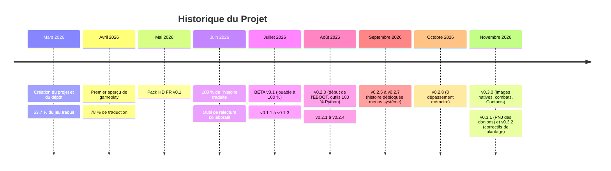

# Journal des Versions - Persona 2: Innocent Sin FR

**Suivi des releases, corrections techniques et historique du projet**

 

 

> [!NOTE]
> Ce document résume chaque version publiée. Les notes complètes sont sur la page
> [Releases](https://github.com/Grimoire-du-Coeur/P2-IS-FR-PSP/releases).
> Pour contribuer, voir [CONTRIBUTING.md](../CONTRIBUTING.md).

> [!IMPORTANT]
> **Prenez toujours la dernière version.** Les v0.3.1 et antérieures ont des
> plantages connus (chargement infini au parc d'Aoba, PC de Baofu) corrigés dans la v0.3.2.

 

---

## État d'Avancement

| Fichier / Composant | Contenu | Progression |
|:---|:---|:---:|
| `event.bin` | 399 scripts d'histoire | **100 %** |
| `MMAP01` à `MMAP06` | Dialogues des PNJ sur les cartes | **100 %** |
| `DNGSCN.BNP` | PNJ du lycée et des donjons | **~97 %** |
| `P_DEMO.BNP` | Textes de démonstration | **100 %** |
| `CD_SHOP.BNP` | Boutique de CD | **100 %** |
| `F_BE.BNP` | Répliques de combat | **159 / 160** |
| `TM_EVE.BNP` | Réponses des démons (Contacts) | **~85 %** (format complexe pour le reste) |
| `EBOOT.BIN` | Menus, noms, descriptions (6 574 entrées) | **~100 %** |
| Images natives (ISO) | Menus, combat, boutiques | **31 images** |
| Pack HD (PPSSPP) | Interface haute définition | **beta 0.3** |
| `q00.bin` | Climax Theater (mode Quête) | **Prévu avec les quêtes DLC** |

 

---

## Frise Chronologique

 

---

## Historique des Versions

### BÊTA v0.3.2 - *Novembre 2026*
**Correctif critique, à installer absolument.** L'outil des menus écrasait des données du jeu juste après certains textes : chargement infini au parc d'Aoba, sauvegardes qui ne se rechargent pas, plantage après Igor. Corrigé et vérifié par un test. Plantage du **PC de Baofu** corrigé, menus du PC traduits. Plus aucune réplique de l'histoire coupée (13 réécrites), 94 réponses de démons en français, 159 répliques de combat sur 160. « ï » qui s'affichait « ü » corrigé, Papa Métal / Mama Métal et « Fainéant » harmonisés.

### BÊTA v0.3.1 - *7 Novembre 2026*
PNJ du lycée et des donjons traduits (`DNGSCN.BNP`), énigme de la forêt des divinités gardiennes jouable en français, Personae et profils. *Contient les plantages corrigés en v0.3.2.*

### BÊTA v0.3.0 + Pack HD beta 0.3 - *6 Novembre 2026*
31 images traduites directement dans l'ISO (visibles sur vraie PSP), nouveau Pack HD, 95 répliques de combat (`F_BE`) traduites avec un encodeur réécrit, Contacts (`TM_EVE`) et CD Shop traduits.

### BÊTA v0.2.8 - *10 Octobre 2026*
0 dépassement mémoire sur 100 % des scripts d'histoire (393 répliques condensées), suppression de textes parasites collés dans les dialogues (Concierge, Jun dans les temples...).

### BÊTA v0.2.7 - *27 Septembre 2026*
Fin des caractères glitchés entre les répliques (`LL"`, `ΓΓ"`), boutique de Tony nettoyée, coupures et débordements corrigés.

### BÊTA v0.2.6 - *19 Septembre 2026*
Menus de base et réglages traduits (EBOOT), 62 boutiques nettoyées, écran titre complet.

### BÊTA v0.2.5 - *15 Septembre 2026*
Crashs du Musée et de Baofu corrigés (histoire débloquée), word-wrap limité à 3 lignes sur les 399 scripts.

### BÊTA v0.2.4 - *30 Août 2026*
303 menus de boutiques réparés, `]Acheter` supprimé, noms des Sœurs harmonisés, débordements corrigés.

### BÊTA v0.2.3 - *30 Août 2026*
L'encodeur gère le format `EBOOT_decoupe`, choix de menus plus tronqués, 34 menus corrompus réparés, ponctuation harmonisée.

### BÊTA v0.2.2 - *22 Août 2026*
Menus de rumeurs réparés (pointeurs absolus), noms de PNJ nettoyés, pagination refaite sur 1 018 boîtes.

### BÊTA v0.2.1 - *21 Août 2026*
Balises inversées corrigées sur 1 800 lignes, alignement mémoire, `É` majuscule, points de suspension automatiques.

### BÊTA v0.2.0 - *19 Août 2026*
Début de la traduction de l'EBOOT (14 %), 690 balises repositionnées, plus besoin d'outils Windows externes : tout est en Python.

### BÊTA v0.1.3 - *24 Juillet 2026*
Révision du scénario sur les 399 scripts, sauts de ligne corrigés.

### BÊTA v0.1.2 - *21 Juillet 2026*
Correction des crashs mémoire (padding `[SP]` au lieu d'octets nuls), boîtes de choix stabilisées.

### BÊTA v0.1.1 - *17 Juillet 2026*
Retour à la ligne automatique, révision typographique.

### BÊTA v0.1 - *10 Juillet 2026*
Première bêta publique, jouable du début à la fin.

### Pack HD FR v0.1 - *6 Mai 2026*
Premières textures françaises, à superposer sur le pack HD anglais de Karasu.
